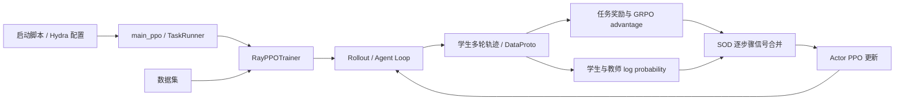

# verl 架构与 SOD 适配说明

本文以本仓库中的 `verl 0.5.0.dev` 代码为准，说明训练流程、主要目录的职责，以及 SOD（Step-wise On-policy Distillation）在 verl 中的接入位置。该版本号见 `verl/version/version`；本仓库包含针对 SOD 的修改，不能将其等同于未经修改的官方版本。

## 训练流程



`examples/SOD/run_sod.sh` 通过 Hydra 配置启动 `verl.trainer.main_ppo`。`main_ppo.py` 初始化 Ray 和 worker 角色；`ppo/ray_trainer.py` 负责组织采样、打分、计算训练信号、更新及保存。各组件通过 `verl/protocol.py` 中的 `DataProto` 传递批次。

## 主要目录

| 路径 | 职责 | SOD 中的用途 |
| --- | --- | --- |
| `verl/trainer/` | 训练入口、配置、PPO/GRPO 训练循环及算法函数 | 接入教师概率计算、逐步骤权重和 advantage 合并 |
| `verl/workers/` | Actor、rollout、reference、critic 等 GPU worker；FSDP 和 Megatron 实现 | 加载独立教师模型并沿用 actor 更新 |
| `verl/experimental/agent_loop/` | 多轮生成、工具调用和观察拼接 | 生成学生轨迹和 `response_mask` |
| `verl/tools/` | 工具接口、注册与执行适配 | 提供 SandboxFusion 等工具能力 |
| `verl/protocol.py` | `DataProto` 批次协议 | 携带轨迹、mask、奖励、概率与 advantage |
| `verl/single_controller/` | Ray 资源池、worker group、远程调用 | 调度分布式 worker |
| `verl/utils/` | 数据集、奖励、检查点、日志及张量工具 | 复用通用基础设施 |
| `verl/models/`、`verl/third_party/` | 模型及 vLLM、SGLang 等后端适配 | 复用现有实现 |
| `recipe/demystify/` | 任务数据、奖励和代码执行工具配置 | 适配本项目的题型与 SandboxFusion |
| `examples/SOD/` | SFT、SOD 训练和评测脚本 | 指定数据、模型及实验参数 |

## SOD 的实现与改动

### 1. 配置和 worker 创建

`verl/trainer/config/algorithm.py` 的 `TokenKLRegConfig` 增加 `stepwise_enable`、`stepwise_epsilon`、`stepwise_delta` 和 `stepwise_opd_coef`。`examples/SOD/run_sod.sh` 启用这些参数，并设置 `adv_estimator=grpo`、异步 vLLM 多轮工具 rollout、学生与教师路径。当前脚本关闭了常规的 `use_kl_in_reward` 和 actor `use_kl_loss`。

即使关闭上述两种常规 KL 用途，SOD 仍需教师对学生轨迹打分。为此，`verl/trainer/main_ppo.py` 的 `add_ref_policy_worker` 在 `token_kl_reg.enable` 时创建 reference worker。`verl/workers/fsdp_workers.py` 允许 reference worker 从 `actor_rollout_ref.ref.model.path` 加载独立教师模型，而非默认复用学生模型。

### 2. 学生轨迹与步骤边界

`verl/experimental/agent_loop/tool_agent_loop.py` 将学生生成的 token 标为 `response_mask=1`，工具观察标为 0。`verl/trainer/ppo/ray_trainer.py` 的 `_extract_step_boundaries` 将每段连续的 1 视为一个 assistant 步骤。这个步骤定义依赖 mask 的排列；更换 Agent Loop 或轨迹格式时应重新核对。

### 3. 教师打分与逐步骤权重

训练循环先重算学生轨迹的 `old_log_probs`，再通过 reference worker 计算同一轨迹的 `ref_log_prob`。教师仅用于打分，更新的是学生。对于第 `k` 个步骤，`compute_stepwise_opd_weights` 计算学生与教师在该步骤 token 上的平均绝对 log probability 差：

```text
d_k = mean_{t 属于步骤 k} |log π_student,old(y_t) - log π_teacher(y_t)|
w_1 = 1
w_k = min((d_1 + ε) / (d_k + ε), 1 + δ), k > 1
```

代码用相邻步骤比值的累乘实现 `w_k`；该乘积在代数上约掉中间项，得到上述表达式。工具观察和 padding 不参与步骤差异计算。偏离变大时权重减小，偏离变小时权重恢复，上限为 `1+δ`。

### 4. 与 GRPO 合并并更新 Actor

`ray_trainer.py` 先根据任务奖励计算 GRPO advantage，然后由 `_apply_token_kl_regularizer` 生成逐 token 蒸馏信号并写回 `batch.batch["advantages"]`：

```text
A_total,t = A_GRPO,t
          + λ · w_step(t) · [log π_teacher(y_t) - log π_student,old(y_t)]
```

这里的 `λ` 是 `stepwise_opd_coef`。最终 advantage 交给 `verl/workers/actor/dp_actor.py` 的既有 PPO 策略损失。此实现将教师指导加入 advantage，没有另写独立的蒸馏 KL loss，也无需修改 `single_controller` 或底层分布式执行机制。

### 5. 任务适配

`recipe/demystify/reward.py` 负责数据映射、提示词、SandboxFusion 工具包装，以及数学题和代码题的规则奖励；`recipe/demystify/sandbox_fusion_tool_config.yaml` 配置代码执行服务。这些是实验环境与奖励适配，和逐步骤权重公式分开。

## 阅读与移植顺序

1. 从 `examples/SOD/run_sod.sh` 看配置入口。
2. 在 `verl/trainer/ppo/ray_trainer.py` 中依次阅读 `fit`、`compute_stepwise_opd_weights` 和 `_apply_token_kl_regularizer`。
3. 回看 `verl/experimental/agent_loop/tool_agent_loop.py` 中 `response_mask` 的形成方式。
4. 核对 `verl/trainer/main_ppo.py` 的 reference worker 创建条件，以及 `verl/workers/fsdp_workers.py` 的教师路径加载。
5. 如需更换任务，再检查 `recipe/demystify/` 的数据、工具和奖励实现。
